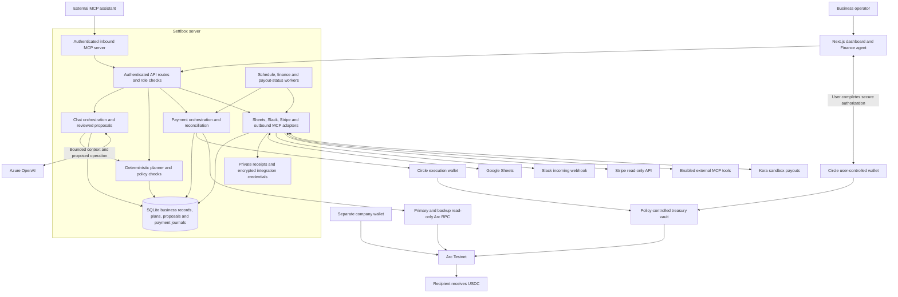
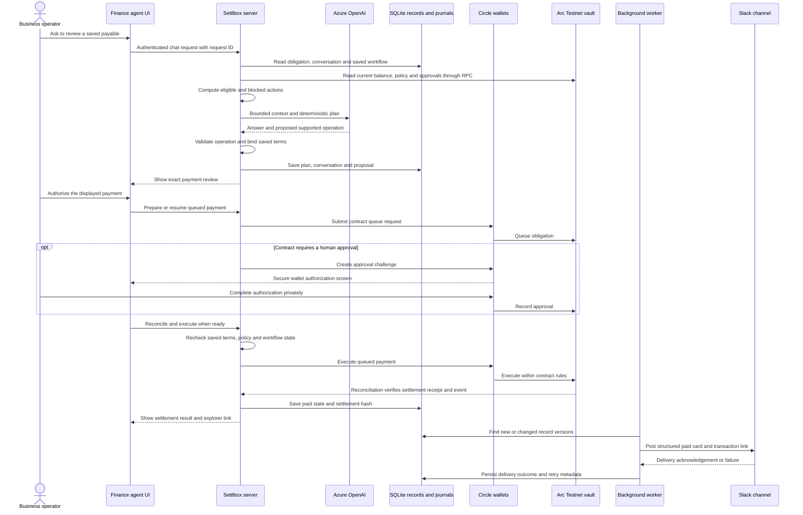

# Settlbox

Settlbox is a stablecoin-native business finance platform that connects treasury, invoices, payroll and contractor payments to an AI Finance agent. It turns saved business obligations into policy-checked actions, authorized USDC settlement on Arc and a traceable record of what happened.

The broader vision is a business account for global collections, payroll and USD treasury management. The current implementation is an **Arc Testnet prototype**. Live banking, fiat payouts, yield and universal onboarding eligibility are not represented as available services.

## The problem

Small businesses and distributed teams manage cash, incoming invoices, bills and contractor payments in separate tools. Knowing a balance is not enough: an operator also needs to know what is due, which cash is already committed, what can be paid within policy and which decisions require attention.

Settlbox brings those obligations and payment controls into one workflow. Its current focus is explainable payment preparation and traceable execution, rather than replacing every bank account or accounting system.

## What the agent decides

| Decision | Evidence and boundary |
| --- | --- |
| Which obligations need attention first | Orders saved obligations by due date and explains eligible versus blocked items. This is a deterministic priority rule, not learned payment-timing optimization. |
| What cash is available for proposed payments | Uses the selected funding source, existing commitments, liquidity floor and additional reserve. Uncollected invoices are not cash. |
| Which payments must stop or escalate | Checks recipient permissions, payment limits, remaining daily capacity, liquidity and active workflows. The language model cannot override these checks. |
| Which business action to prepare | Resolves a supported operation from the conversation and saved context, then presents its exact terms for review. |
| Whether an execution can proceed | The server and contract recheck the saved payment and applicable approvals. An enabled worker can reconcile and execute already-ready payments within policy; it cannot create human signatures. |

The model explains and proposes; deterministic checks and contract rules enforce authority. The current prototype does not independently negotiate vendor terms, screen sanctions, infer milestone completion or optimize yield.

## How it works

1. Create an obligation manually, ask the Finance agent to prepare it, or import reviewed drafts from Google Sheets.
2. Ask what needs attention. The agent explains due-date priorities, protected liquidity, eligible payments and blocked obligations using saved records and current policy.
3. Review the proposed action. Payments require the applicable human wallet authorization and contract approvals.
4. Verify USDC settlement on Arc Testnet, with saved payment state and a transaction hash.
5. With Slack notifications enabled, the background worker posts structured record updates with a transaction link when a settlement hash is recorded.

Uncollected invoices are excluded from spendable cash. A completed action review does not itself prove payment settlement. Execution rechecks current balances, permissions and limits.

## Verified workflow example

A saved test bill for **0.001 USDC** was prepared through the Finance agent, reviewed in Settlbox and authorized by the operator. It settled on Arc Testnet, was recorded as paid, and produced a Slack card with the actual transaction link:

[View the verified Arc Testnet transaction](https://testnet.arcscan.app/tx/0xcc534c3310eb51b699b94ba2f7610e9d29658ff384c490e23e66bf8e35d5ad15)

The broader rehearsal also verified Google Sheets draft import/export and an analysis that distinguished eligible bills, protected liquidity, blocked obligations and unpaid invoices. These are engineering verification results using test assets; they are not evidence of commercial payment volume or customer adoption. Public customer-adoption metrics are not reported here.

To explore the workflow in a configured workspace, ask:

- “What needs attention, which bills are eligible for review, and why are the others blocked?”
- “How much cash is protected, and what remains after the eligible payments?”
- “Prepare a draft bill for [counterparty] for [amount] USDC, due [date], to [wallet]. Do not pay it.”
- “Open payment review for [saved bill title]. Keep its amount and recipient unchanged.”

Use the actual saved record names and permitted recipients. Review exact details before authorizing. Open **Financial decision summary** and **Agent audit trail** on the Finance agent page to inspect the saved evidence. Live use needs configured wallets and providers; cloning the repository alone does not provision them.

## Implemented capabilities

- **Finance agent:** conversational analysis and reviewed actions, saved conversations, financial decision summaries and a visible agent audit trail. Analysis is based on recorded obligations, not a forecast of unknown expenses.
- **Treasury:** Circle wallet integration, a contract-enforced payment vault, recipient allowlists, spending limits, liquidity protection, human approvals, durable reservations and idempotent payment handling.
- **Invoices and receivables:** saved invoices, branded printable documents, payment links, Arc USDC collection and settlement reconciliation.
- **Payroll and contractors:** employee/contractor records, agreements, bills and recurring schedules that prepare drafts. Scheduling does not bypass approval.
- **Expenses:** reimbursements, private receipt uploads, review and payment workflows.
- **Google Sheets:** OAuth connection, reviewed imports of up to 100 draft rows with stable source IDs, and exports of up to 1,000 saved records into a new spreadsheet. Import/export is explicit; automatic two-way sync is not implemented.
- **Slack:** incoming webhook connection, opt-in background record notifications, structured payment cards and a delivery audit.
- **Stripe:** restricted-key, read-only snapshots of the latest 100 customers, invoices and charges per category. Manual refresh; no payment mutations or automatic full-history sync. Real-account verification remains pending.
- **MCP:** authenticated access for external assistants to read supported context and propose actions for review, plus configurable outbound MCP connections. Assistants cannot bypass wallet authorization.
- **Access and records:** authenticated sessions, role restrictions, signed team invitations, durable business records and saved payment outcomes.

The company wallet and payment vault are **separate funding sources**. The current dashboard balance reads the company wallet; vault payments reduce the vault balance. Neither represents every asset held by the business.

## Architecture

The dashboard, Finance agent and manual screens share server-side business records. The language model proposes supported operations; deterministic policy checks, explicit reviews and contract rules govern execution.



**Boundaries:** model output is not payment authorization. Wallet PINs and private keys are not supplied to the model. Server credentials stay out of browser configuration. The vault and company wallet are separate addresses and balances. Stripe snapshots and Kora sandbox balances do not become spendable Arc funds. External MCP tools require review and remain subject to their configured permissions.

### Agent payment sequence

This is the implemented vault-payment path. Manual record entry and reviewed Sheets imports can create the same saved obligation before the conversation begins.



The enabled finance worker can also execute already-ready payments within policy. It cannot supply human signatures. Slack notification processing is independent of the finance cycle, and an uncertain notification is not automatically resent.

### Repository map

| Location | Responsibility |
| --- | --- |
| `app/agent/` | Conversation, action/payment reviews, decision summary and audit UI |
| `presentation/` | Dashboard, manual workflows, Settings and shared components |
| `app/api/` | Authenticated business, payment, integration and MCP endpoints |
| `services/arc/` | Exact amounts, deterministic planning and payment policy utilities |
| `services/server/` | Persistence, agent orchestration, wallet/provider adapters and reconciliation |
| `contracts/` | Treasury vault and gift escrow contracts and artifacts |
| `scripts/` | Production launcher, background workers and verification scripts |
| `tests/` | Policy, persistence, authorization, recovery and integration tests |
| `docs/` | Setup guides and verification history |
| `.data/` | Private local runtime configuration, databases, uploads and verification artifacts; not source-controlled |

## Verification

Live checks have verified Sheets draft import/export, agent analysis and review, user-authorized Arc Testnet USDC settlement, audit records and Slack background notifications. A paid Slack card was checked against an actual successful transaction receipt.

The latest recovery verification passed **166 automated tests**, application type checking and the production build. Failure-path tests cover read-only RPC failover, bounded Slack rate-limit retries and duplicate protection. An isolated live test recovered through the backup Arc RPC after its primary was deliberately made unavailable. Integration HTTP checks also use mocked providers; these do not establish live-provider readiness.

See [the readiness audit](docs/workflow-readiness-audit.md) for detailed evidence and limitations.

## Development

Use Node.js 24 or newer. Run `npm ci`, copy `.env.example` to `.env.local`, and privately configure the services you use. Never commit credentials, wallet secrets or local databases.

```sh
npm run dev -- --port 3002
```

For production, run `npm run build`, set the `PORT` environment variable to `3002` if desired, then run `npm start`. The production launcher starts configured schedule, finance and payout-status workers while the process remains running.

```sh
npm test
npm run typecheck
npm run typecheck:arc
npm run build
```

Setup guides: [Google Sheets](docs/google-sheets-setup.md), [Slack and Stripe](docs/slack-stripe-setup.md), and [.env.example](.env.example).

Circle credentials remain server-side. Operator sessions expire after one hour. Configuration, SQLite databases and private uploads live under `.data` by default. Preserve the integration encryption key and use persistent storage. Distributed deployments require appropriate shared transactional storage.

Scripts such as `verify:circle`, `verify:api` and gift deployment/verification can provision wallets, deploy contracts or send test funds when configured. Inspect their setup and payment terms before running them; they are not ordinary read-only health checks.

## Reliability and audit boundaries

Arc reads use bounded retries and a documented backup endpoint. Missing current chain data fails closed. Slack batches are paced; confirmed rate-limit rejections respect `Retry-After` with a three-attempt cap. Ambiguous deliveries remain uncertain and are not automatically resent. External outages remain possible.

The agent audit view exposes recent saved conversations, decision snapshots and available proposal states. These are application records, not an immutable event ledger or the model's private reasoning. Transaction receipts provide separate evidence of settlement.

## Access-dependent and unfinished capabilities

- USYC investment/redemption requires approved access and completed execution integration. No fixed APY is promised.
- Kora payout workflows are sandbox-only. Live funding, bank/mobile-money payouts and on/off ramps require provider approval and supported-market integration.
- Card issuing and bank-account provisioning require external providers.
- Cross-chain liquidity consolidation, FX conversion, broad counterparty screening, subscription usage monitoring and milestone releases are not demonstrated end to end.
- Sheets automatic two-way sync, Stripe real-account verification and complete integration-state awareness in chat remain unfinished.

Mainnet company disbursements are disabled. The prototype does not establish production compliance, global availability or eligibility without a particular legal entity.

## License

MIT. See [LICENSE](LICENSE). The original BuidlGuidl copyright notice is preserved.
